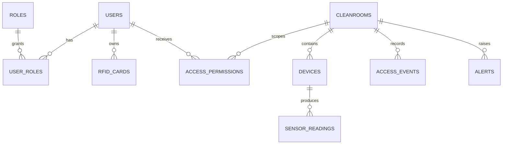

# CleanSpace API

Backend REST para el prototipo académico CleanSpace. Está separado del frontend Next.js y usa FastAPI, SQLite, SQLAlchemy, JWT y Argon2id.

## Ejecutar en Windows

```powershell
cd backend
py -3.11 -m venv .venv
.venv\Scripts\Activate.ps1
pip install -r requirements.txt
copy .env.example .env
# Edita .env y cambia JWT_SECRET_KEY, RFID_HMAC_KEY e INITIAL_ADMIN_PASSWORD
# si tienes Windows 11 con Python 3.13 instalado, usa `python` y no `py -3.11`
python -m scripts.seed_data
uvicorn app.main:app --reload --host 127.0.0.1 --port 8000
```

Si PowerShell bloquea la activación: `Set-ExecutionPolicy -Scope Process Bypass`.

## Ejecutar en macOS/Linux

```bash
cd backend
python3.11 -m venv .venv
source .venv/bin/activate
pip install -r requirements.txt
cp .env.example .env
python -m scripts.seed_data
uvicorn app.main:app --reload --host 127.0.0.1 --port 8000
```

Documentación interactiva: http://127.0.0.1:8000/docs. Health: http://127.0.0.1:8000/health.

## Conectar Next.js

Configura el frontend para llamar a `http://127.0.0.1:8000/api/v1` y conserva `CORS_ORIGINS=http://localhost:3000`. Login usa email/password y devuelve access token + refresh token. El access token dura 15 minutos y el refresh 7 días; cada refresh rota y revoca el anterior.

## Seguridad y límites del prototipo

Las contraseñas usan Argon2id. Los refresh tokens se guardan únicamente como hash. Los UID RFID se guardan como HMAC con clave del entorno y nunca se escriben en logs. Roles (`ADMINISTRADOR`, `SUPERVISOR`, `PERSONAL_AUTORIZADO`) son distintos de los permisos por cuarto. La validación RFID debe autenticarse por dispositivo antes de exposición real; aquí la simulación queda preparada para completar esa capa con mTLS o claves rotatorias por dispositivo. La API decide `AUTORIZADO`/`DENEGADO`, pero no abre físicamente una puerta.

En producción reemplaza SQLite por PostgreSQL, usa HTTPS, secretos gestionados, migraciones Alembic, autenticación de dispositivos y revisión de autorización por cuarto para cada endpoint.

## Migraciones

La aplicación crea tablas al iniciar para facilitar el prototipo. Alembic está incluido como dependencia; para una instalación productiva inicializa `alembic init migrations`, configura `target_metadata = Base.metadata` y usa `alembic revision --autogenerate` / `alembic upgrade head`.

## ER resumido


