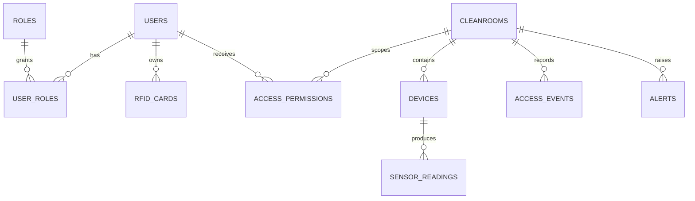

# CleanSpace API

Backend REST para el prototipo académico CleanSpace. Está separado del frontend Next.js y usa FastAPI, SQLite, SQLAlchemy, JWT y Argon2id.

## Docker

Desde la raíz `clean-space-backend`, inicia PostgreSQL:

```bash
docker compose up -d
```

El Compose solo levanta PostgreSQL, igual que `ClaseAutenticacion`; publica el puerto 5437 y conserva los datos en `cleanspace_postgres_data`. La contraseña predeterminada es únicamente para desarrollo. Para conectar FastAPI, copia `backend/.env.example` a `backend/.env`; su `DATABASE_URL` apunta a `localhost:5437`.

Después, ejecuta la API desde la carpeta `backend` con los pasos de instalación indicados abajo. Si modificas usuario o contraseña de PostgreSQL en Compose, actualiza también `DATABASE_URL` en `backend/.env`.

Para apagar PostgreSQL sin borrar la base de datos: `docker compose down`. Para borrar también los datos persistidos: `docker compose down -v`.

## Ejecutar en Windows

```powershell
cd backend
python -m venv .venv
.venv\Scripts\activate.bat
pip install -r requirements.txt
copy .env.example .env
# Edita .env y cambia JWT_SECRET_KEY, RFID_HMAC_KEY e INITIAL_ADMIN_PASSWORD
# si tienes Windows 11 con Python 3.13 instalado, usa `python` y no `py -3.11`
python -m scripts.seed_data
python -muvicorn app.main:app --reload --host 127.0.0.1 --port 8000
```

Si PowerShell bloquea la activación: `Set-ExecutionPolicy -Scope Process Bypass`.

## Ejecutar en macOS/Linux

```bash
cd backend
python3.11 -m venv .venv
source .venv/bin/activate
pip install -r requirements.txt
cp .env.example .env
python -m scripts.seed_data
python -m uvicorn app.main:app --reload --host 127.0.0.1 --port 8000
```

Documentación interactiva: http://127.0.0.1:8000/docs. Health: http://127.0.0.1:8000/health.

## Documentación automática de endpoints

FastAPI genera la documentación OpenAPI/Swagger automáticamente a partir de los decoradores y modelos Pydantic. Esto permite mantener todos los endpoints sincronizados sin duplicar la especificación a mano.

URLs disponibles cuando el servicio corre:

- Swagger UI: http://127.0.0.1:8000/docs
- OpenAPI JSON: http://127.0.0.1:8000/openapi.json
- ReDoc: http://127.0.0.1:8000/redoc

Resumen de grupos principales:

- Autenticación: `/health`, `/api/v1/auth/login`, `/api/v1/auth/refresh`, `/api/v1/auth/logout`, `/api/v1/auth/me`
- Administración: `/api/v1/roles`, `/api/v1/personas`, `/api/v1/cuartos`, `/api/v1/dispositivos`, `/api/v1/tarjetas`, `/api/v1/permisos`
- Control de acceso RFID: `/api/v1/access-logs/`, `/api/v1/permissions/`, `/api/v1/device/sync`, `/api/v1/device/access`, `/api/v1/device/events`
- IoT y control: `/api/v1/iot/auth`, `/api/v1/iot/heartbeat`, `/api/v1/iot/telemetria`, `/api/v1/iot/acceso/validar`, `/api/v1/iot/comandos/pendientes`, `/api/v1/iot/comandos/{id}/ack`
- Monitoreo y analítica: `/api/v1/comandos`, `/api/v1/monitoreo/lecturas`, `/api/v1/monitoreo/historico`, `/api/v1/accesos`, `/api/v1/avisos`, `/api/v1/analitica/*`, `/api/v1/dashboard/admin/summary`

Si quieres exportar esta documentación fuera de la app, basta con usar el esquema OpenAPI y generarlo en Postman, Redocly o una página estática.

## Conectar Next.js

Configura el frontend para llamar a `http://127.0.0.1:8000/api/v1` y conserva `CORS_ORIGINS=http://localhost:3000`. Login usa email/password y devuelve access token + refresh token. El access token dura 15 minutos y el refresh 7 días; cada refresh rota y revoca el anterior.

## Seguridad y límites del prototipo

Las contraseñas usan Argon2id. Los refresh tokens se guardan únicamente como hash. Los UID RFID se guardan como HMAC con clave del entorno y nunca se escriben en logs. Roles (`ADMINISTRADOR`, `SUPERVISOR`, `PERSONAL_AUTORIZADO`) son distintos de los permisos por cuarto. La validación RFID debe autenticarse por dispositivo antes de exposición real; aquí la simulación queda preparada para completar esa capa con mTLS o claves rotatorias por dispositivo. La API decide `AUTORIZADO`/`DENEGADO`, pero no abre físicamente una puerta.

Las rutas `/api/v1/permissions/` requieren el header `X-Admin-Key` configurado en `CLEANSPACE_ADMIN_KEY`; las rutas `/api/v1/device/*` requieren `X-Device-Key` configurado en `CLEANSPACE_DEVICE_KEY`. Al copiar `.env.example` a `.env`, cambia ambas claves de ejemplo por valores privados.

En producción reemplaza SQLite por PostgreSQL, usa HTTPS, secretos gestionados, migraciones Alembic, autenticación de dispositivos y revisión de autorización por cuarto para cada endpoint.

## Migraciones

La aplicación crea tablas al iniciar para facilitar el prototipo. Alembic está incluido como dependencia; para una instalación productiva inicializa `alembic init migrations`, configura `target_metadata = Base.metadata` y usa `alembic revision --autogenerate` / `alembic upgrade head`.

## ER resumido


